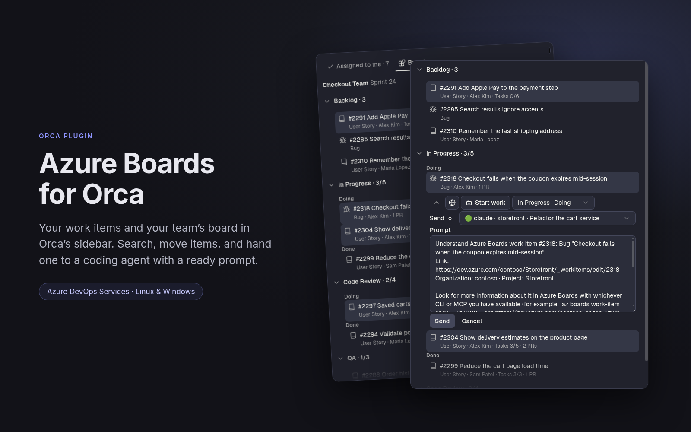

# Azure Boards for Orca



Your Azure Boards work items in [Orca](https://github.com/stablyai/orca)'s sidebar: see what is assigned to you and your team's board, move items, and hand one to a coding agent with a ready prompt.

Azure DevOps Services (`https://dev.azure.com/<organization>`) only. It needs no Azure Repos: your code can live anywhere. Works on Linux and Windows.

**[Português (Brasil)](#português-brasil)**

---

## Contents

- [Features](#features)
- [Quick start](#quick-start)
- [Using the panel](#using-the-panel)
- [Start work](#start-work)
- [Settings](#settings)
- [Permissions](#permissions)
- [Troubleshooting](#troubleshooting)
- [Limitations](#limitations)
- [How it works](#how-it-works)
- [Development](#development)

## Features

| | |
|---|---|
| **Assigned to me** | Your open work items, newest change first, grouped by state, by board column or not at all. |
| **Board** | Your team's board for the current iteration: real columns and order, Doing/Done halves, WIP limits (`In Progress · 3/7`), your items highlighted, and a switch between the Epics, Features and Stories boards. |
| **At a glance** | The type's icon, child tasks done (`Tasks 1/4`) and linked GitHub pull requests (`2 PRs`) on every item. |
| **Search** | Filter either tab by number (`123`, `#123`) or by part of the title, ignoring case and accents. |
| **Move to** | Change an item's state, or its board column and Doing/Done half, without leaving Orca. |
| **Start work** | Send an item to a coding agent already open in Orca, or to a new worktree with a new agent. |
| **Clean titles** | Hides the leading `[Team or area name]` that many teams put in titles: `[Web Team] Fix login` reads `Fix login`. |
| **Stays fresh** | Reloads the visible tab every 5 minutes (configurable or off). |
| **Clear errors** | A refused PAT, a missing scope, a wrong organization, an untrusted certificate or no connection each get their own message and fix. |
| **Two languages** | The panel follows Orca's language: English or Brazilian Portuguese. |

## Quick start

1. **Install** the plugin (Orca 1.4.264 or newer):

   ```bash
   orca plugin install fabiopbarbieri/azure-boards-orca-plugin
   ```

   Orca lists what the plugin asks for and prints an approval fingerprint; run the command again with `--approve <fingerprint>`. You can also install it from **Settings → Plugins**.

2. **Create a personal access token** in Azure DevOps, under **User settings → Personal access tokens**. Scope it to your organization (Microsoft is retiring "All accessible organizations" tokens) and give it the scopes of the features you want. Start small; the panel tells you which scope is missing when you try something that needs more.

   | Scope | Unlocks |
   |---|---|
   | **Work Items (Read)** | Required: both tabs, search and Start work. |
   | **Project and Team (Read)** | The full project list in the project filter, and the team picker for the Board tab. |
   | **Work Items (Read & write)** | **Move to**. |

3. **Connect.** Open the **Azure Boards** panel, enter the **organization** (its name, or paste the URL) and the **PAT**, and press **Connect**. Nothing is saved until Azure DevOps accepts them.

4. **Choose a board** (optional). In the panel's settings, under **Board**, pick the project and team whose board the **Board** tab shows, then press **Save**.

## Using the panel

### Assigned to me

Every open work item assigned to you (`[System.AssignedTo] = @Me`), up to 200, newest change first. The menu in the toolbar groups them by **state** (in the process's order: proposed, in progress, resolved, completed), by **board column**, or not at all. States listed in **Hidden states** (Closed, Done and Removed by default) are left out.

Each line shows the number and title, then the type, the state or column, child tasks done, linked pull requests and, when your items span several projects, the project.

### Board

Your team's board for its current iteration, with every item on it, not only yours. Columns keep the board's order and WIP limits; a split column shows its **Doing** and **Done** halves; done columns start folded. Your own items are highlighted. The menu next to the toolbar switches between the team's **Epics**, **Features** and **Stories** boards.

### Item actions

Click an item to open its actions; click it again, or the close button, to fold them.

| Action | What it does |
|---|---|
| 🌐 **Open in browser** | Opens the item in Azure DevOps in your system browser. The first time, Orca asks before it opens `dev.azure.com`. |
| **Start work** | Sends the item to a coding agent. See [Start work](#start-work). |
| **Move to** | **Assigned to me**: another state of the item's type. **Board**: another column, or the Doing or Done half of a split column; the state follows the column, as on the board. The tab reloads afterwards. If Azure DevOps refuses (a state transition or a rule of your process), its message shows in the item. |

### Search, folding and refresh

- The **magnifier** opens a search box. Groups and columns with matches open while you search; closing the box clears it. Searching never calls Azure DevOps again.
- Groups and columns fold, and the panel remembers which ones you folded.
- **Refresh** reloads the visible tab now; it also reloads by itself every 5 minutes while the panel is visible.

## Start work

**Start work** turns a work item into a prompt for a coding agent, so it can start from the item instead of from scratch.

**Where it goes.** The **Send to** menu lists:

- the agents already open in Orca, by kind, project and terminal title, with their state: 🟢 free, 🟡 waiting for you, ⏳ working, 🔴 blocked. Free ones come first. The prompt is typed into the agent's terminal, and Orca shows it.
- **New worktree**: a new Git worktree in one of your Orca projects, with a new agent of the kind you pick. The agent list has the kinds you have used in Orca, then Claude, Codex, Kiro and Gemini. The worktree name starts as `wi-<number>-<title>`.

The panel remembers the Orca project you used for each Azure DevOps project, and the agent kind you picked last.

**What the prompt says.** It is filled in for you and you can edit it before sending. It gives the item's number, type, title, link, organization and project, its description, acceptance criteria and repro steps, and asks the agent to look for more in Azure Boards (comments, child and related items, links, history) with whatever it has (for example `az boards work-item show` or the Azure DevOps MCP), then explain what it understood and propose a plan before changing code.

> **Tip:** the agent reads Azure Boards with its own tools. Install the [Azure CLI with the azure-devops extension](https://learn.microsoft.com/azure/devops/cli/) or an Azure DevOps MCP server where your agents run; the plugin's PAT is never shared with them.

## Settings

### In the panel

Open the panel's **Settings** (gear icon). Each section folds and shows its current value. Changes stay a draft until **Save**; **Back** discards them.

| Section | What you set |
|---|---|
| **Connection** | The organization and the PAT. To change either, delete the stored PAT with the trash button and connect again. The PAT is not part of Save. |
| **Projects** | **All projects** (including ones you gain access to later), or only the ones you tick. Only projects you can access are listed. |
| **Board** | The project and team whose board the Board tab shows. |
| **Display** | Remove the area prefix from titles. |
| **Refresh** | How often the visible tab reloads: off, 5, 15 or 30 minutes. |

### In Orca's Settings

Under **Settings → Plugins → Azure Boards** (labels in English: Orca does not translate plugin settings yet):

| Setting | Default | Effect |
|---|---|---|
| Organization | empty | The name in `https://dev.azure.com/<organization>`. |
| Group work items by | State | No grouping, State or Board column. Same as the panel's menu. |
| Remove the area prefix from titles | on | Hides a leading `[...]` that matches a segment of the item's area path. In `[Web Team \| 1234 \| Service]` only the area goes: `[1234 \| Service]`. `[BUG]` stays. |
| Refresh every | 5 minutes | Off, 5, 15 or 30 minutes, while the panel is visible. |
| Hidden states | `Closed, Done, Removed` | Comma-separated states left out of **Assigned to me**. Adjust it to your process. |

The project filter, the chosen board and the Start work choices are kept in the plugin's own storage, by id, so renaming a project does not break them.

## Permissions

The plugin runs as a `trusted-worker`: a Node.js process with your user's access. It only talks to `dev.azure.com`, and the panel itself has no network access. It asks Orca for:

| Capability | Used for |
|---|---|
| `settings:own`, `secrets:own`, `storage:own` | Its own settings, the PAT (encrypted) and its own data. |
| `workspace:read`, `agent:read` | Listing your projects, workspaces and open agents for **Start work**. |
| `history:read` | Listing the agent kinds you have used (titles and counts only, never conversations). |
| `workspace:create`, `workspace:write` | Creating the new worktree and showing the agent's terminal. |
| `agent:launch`, `terminal:send` | Starting the new agent, or typing the prompt into an open one, only when you press **Send**. |

**Your PAT** lives only in Orca's encrypted secrets, together with the organization that accepted it. It is never written to settings, logs or the panel, and it is only sent to `dev.azure.com` for that organization; if you change the organization, the panel asks for a PAT again. Without an OS keyring (Linux without GNOME Keyring or KWallet), the panel says so and does not store it.

## Troubleshooting

| Message | What it means | Fix |
|---|---|---|
| **PAT refused** | Azure DevOps rejected the token: wrong, expired, revoked or for another organization. | Create a new PAT for this organization, delete the stored one under **Connection** and connect again. |
| **Missing permission** | The PAT works but lacks a scope the action needs. | Add the scope (see [Quick start](#quick-start)). |
| **The PAT can't change work items** | **Move to** needs **Work Items (Read & write)**. | Create a PAT with it and reconnect. |
| **Azure DevOps refused the change** | The process does not allow that state transition, or a rule failed. | Read the server's message under it; move in steps or fill the required fields in Azure DevOps. |
| **Not found** | The organization or project does not exist, or you cannot see it. | Check the organization name. |
| **No board chosen** / **No current iteration** | The Board tab has no team yet, or the team has no iteration covering today. | Pick a board in **Settings → Board**, or check the team's iterations in Azure DevOps. |
| **Certificate not trusted** | A proxy on your network inspects HTTPS. | Start Orca with `NODE_EXTRA_CA_CERTS` pointing to the proxy's CA file. |
| **No connection** | The server did not answer. | Check the network, VPN or proxy. |
| **The PAT cannot be stored safely** | Orca has no OS keyring to encrypt secrets. | Install and unlock GNOME Keyring or KWallet, then restart Orca. |
| **Orca has not allowed this yet** (Start work) | The plugin's new permissions are not approved. | Approve them in **Settings → Plugins**. |

`orca plugin logs fabiopbarbieri.azure-boards` shows what the plugin logged; it never logs the PAT or your prompts.

## Limitations

- Azure DevOps Services only; Azure DevOps Server (on-premises) is not supported.
- Up to 200 items per tab.
- Grouping **Assigned to me** by board column orders columns by state category, which is close to, but not always exactly, a board's order. The **Board** tab uses the real order.
- Type icons are Orca's icons matched to Azure DevOps icon names, not the Azure DevOps artwork.
- The agent list for a new worktree cannot tell which agents are installed: Orca does not expose that to plugins.
- Behind a proxy that requires configuration, Node's `fetch` may not use it; this has not been tested.

## How it works

<details>
<summary>Azure DevOps calls</summary>

The panel never touches the network: it asks the plugin's worker with `plugin.request`, and the worker calls the Azure DevOps REST API (version 7.1) with `Authorization: Basic base64(":" + PAT)`.

| Feature | Calls |
|---|---|
| Assigned to me | `POST {org}/_apis/wit/wiql` (filtered by project when you chose some), then `POST {org}/_apis/wit/workitemsbatch` for the fields. |
| Board | `GET {org}/{project}/{team}/_apis/work/boards/{board}` (columns, splits, WIP limits, the board's column fields), `.../work/teamsettings/iterations?$timeframe=current`, `.../work/teamsettings/teamfieldvalues`, then a team-scoped WIQL query and `workitemsbatch`. |
| Counters | `workitemsbatch` with `$expand=relations`: child links and GitHub pull request links. |
| Icons and state order | `GET {org}/{project}/_apis/wit/workitemtypes`, cached for an hour. |
| Move to | `PATCH {org}/_apis/wit/workitems/{id}` (`application/json-patch+json`): `System.State`, plus the board's column and Done fields for a column. |
| Start work | `GET {org}/_apis/wit/workitems/{id}` for the description, acceptance criteria and repro steps. |
| Pickers | `GET {org}/_apis/projects` and `GET {org}/_apis/projects/{project}/teams`. |

A refused PAT can come back as 401, as a redirect to the sign-in page, or as a 203 with an HTML page; all three read as **PAT refused**.

</details>

## Development

```bash
orca plugin validate .                     # manifest and files
orca plugin test .                         # unit and panel tests
orca plugin check .                        # renders each panel scenario
npx -p typescript tsc -p .                 # type check
orca plugin dev load . --approve <fingerprint>
orca plugin logs fabiopbarbieri.azure-boards
```

The panel (`src/panel.tsx`) and the worker (`src/worker.ts`) share one contract, `src/protocol.ts`. Azure DevOps calls live in pure modules (`azure.ts`, `board.ts`, `move.ts`) that take `fetch` as an argument, so tests mock it and never reach the network.

## License

[MIT](LICENSE)

---

## Português (Brasil)

Seus work items do Azure Boards na barra lateral do [Orca](https://github.com/stablyai/orca): veja o que está atribuído a você e o board do seu time, mova itens e passe um deles para um agente de código com o prompt pronto.

Só Azure DevOps Services (`https://dev.azure.com/<organização>`). Não precisa do Azure Repos: o código pode estar em qualquer lugar. Funciona no Linux e no Windows.

### Recursos

| | |
|---|---|
| **Atribuídos a mim** | Seus work items abertos, do mais recente para o mais antigo, agrupados por estado, por coluna do board ou sem agrupamento. |
| **Board** | O board do seu time na iteração atual: colunas e ordem reais, metades Em andamento/Concluído, limites de WIP (`In Progress · 3/7`), seus itens destacados e troca entre os boards Epics, Features e Stories. |
| **Num relance** | Ícone do tipo, tarefas filhas concluídas (`Tarefas 1/4`) e PRs do GitHub vinculados (`2 PRs`) em cada item. |
| **Busca** | Filtra qualquer aba pelo número (`123`, `#123`) ou por um trecho do título, sem diferenciar maiúsculas nem acentos. |
| **Mover para** | Muda o estado do item, ou a coluna do board e a metade Em andamento/Concluído, sem sair do Orca. |
| **Iniciar trabalho** | Manda o item para um agente já aberto no Orca, ou para um worktree novo com um agente novo. |
| **Títulos limpos** | Esconde o `[Nome do time ou da área]` do começo do título: `[Time Web] Ajustar login` vira `Ajustar login`. |
| **Sempre atual** | Recarrega a aba visível a cada 5 minutos (configurável ou desligado). |
| **Erros claros** | PAT recusado, falta de escopo, organização errada, certificado não confiável ou falta de conexão: cada um com sua mensagem e solução. |
| **Dois idiomas** | O painel acompanha o idioma do Orca: português do Brasil ou inglês. |

### Primeiros passos

1. **Instale** o plugin (Orca 1.4.264 ou mais novo):

   ```bash
   orca plugin install fabiopbarbieri/azure-boards-orca-plugin
   ```

   O Orca mostra o que o plugin pede e uma impressão digital de aprovação; rode o comando de novo com `--approve <impressão>`. Também dá para instalar em **Configurações → Plugins**.

2. **Crie um personal access token (PAT)** no Azure DevOps, em **User settings → Personal access tokens**, escopado à sua organização (a Microsoft está desativando os tokens de "All accessible organizations"), com os escopos dos recursos que você quer. Comece pequeno: o painel avisa qual escopo falta quando você tenta algo que precisa de mais.

   | Escopo | Libera |
   |---|---|
   | **Work Items (Read)** | Obrigatório: as duas abas, a busca e o Iniciar trabalho. |
   | **Project and Team (Read)** | A lista completa de projetos no filtro e a escolha do time na aba Board. |
   | **Work Items (Read & write)** | **Mover para**. |

3. **Conecte.** Abra o painel **Azure Boards**, informe a **organização** (o nome ou a URL) e o **PAT** e clique em **Conectar**. Nada é salvo antes de o Azure DevOps aceitar.

4. **Escolha um board** (opcional). Nas configurações do painel, em **Board**, escolha o projeto e o time cujo board a aba **Board** mostra e clique em **Salvar**.

### Usando o painel

**Atribuídos a mim.** Todos os work items abertos atribuídos a você, até 200, do mais recente para o mais antigo. O menu da barra agrupa por **estado** (na ordem do processo: proposto, em andamento, resolvido, concluído), por **coluna do board** ou sem agrupamento. Os estados em **Hidden states** (Closed, Done e Removed por padrão) ficam de fora.

**Board.** O board do seu time na iteração atual, com todos os itens, não só os seus. As colunas seguem a ordem e os limites de WIP do board; coluna dividida mostra as metades **Em andamento** e **Concluído**; colunas de concluído começam recolhidas. Seus itens ficam destacados. O menu ao lado da barra alterna entre os boards **Epics**, **Features** e **Stories** do time.

**Ações do item.** Clique num item para abrir as ações; clique de novo nele, ou no botão de fechar, para recolher.

| Ação | O que faz |
|---|---|
| 🌐 **Abrir no navegador** | Abre o item no Azure DevOps no navegador do sistema. Na primeira vez, o Orca pede confirmação para abrir o `dev.azure.com`. |
| **Iniciar trabalho** | Manda o item para um agente de código. Veja [Iniciar trabalho](#iniciar-trabalho). |
| **Mover para** | **Atribuídos a mim**: outro estado do tipo do item. **Board**: outra coluna, ou a metade Em andamento ou Concluído de uma coluna dividida; o estado acompanha a coluna, como no board. A aba recarrega em seguida. Se o Azure DevOps recusar (transição de estado ou regra do processo), a mensagem dele aparece no item. |

**Busca, recolher e atualizar.** A **lupa** abre a busca; grupos e colunas com resultado abrem durante a busca, e fechar a lupa limpa a busca, sem consultar o Azure de novo. Grupos e colunas recolhem, e o painel lembra quais você recolheu. **Atualizar** recarrega a aba visível na hora; ela também recarrega sozinha a cada 5 minutos com o painel visível.

### Iniciar trabalho

O **Iniciar trabalho** transforma um work item num prompt para um agente de código, para ele começar a partir do item e não do zero.

**Para onde vai.** O menu **Enviar para** lista:

- os agentes já abertos no Orca, com tipo, projeto e título do terminal, e o estado: 🟢 livre, 🟡 aguardando você, ⏳ trabalhando, 🔴 bloqueado. Os livres vêm primeiro. O prompt é digitado no terminal do agente, e o Orca mostra esse terminal.
- **Novo worktree**: um worktree Git novo num dos seus projetos do Orca, com um agente novo do tipo que você escolher. A lista traz os tipos que você já usou no Orca, depois Claude, Codex, Kiro e Gemini. O nome começa como `wi-<número>-<título>`.

O painel lembra qual projeto do Orca você usou para cada projeto do Azure DevOps, e o último tipo de agente escolhido.

**O que o prompt diz.** Ele vem preenchido e dá para editar antes de enviar. Leva número, tipo, título, link, organização e projeto, a descrição, os critérios de aceite e os passos para reproduzir, e pede ao agente para buscar mais no Azure Boards (comentários, itens filhos e relacionados, links, histórico) com o que ele tiver (por exemplo `az boards work-item show` ou o MCP do Azure DevOps), explicar o que entendeu e propor um plano antes de alterar código.

> **Dica:** o agente lê o Azure Boards com as próprias ferramentas. Instale o [Azure CLI com a extensão azure-devops](https://learn.microsoft.com/azure/devops/cli/) ou um servidor MCP do Azure DevOps onde seus agentes rodam; o PAT do plugin nunca é compartilhado com eles.

### Configurações

**No painel** (ícone de engrenagem). Cada seção recolhe e mostra o valor atual. As mudanças ficam em rascunho até **Salvar**; **Voltar** descarta.

| Seção | O que você define |
|---|---|
| **Conexão** | A organização e o PAT. Para trocar, apague o PAT guardado com a lixeira e conecte de novo. O PAT não entra no Salvar. |
| **Projetos** | **Todos os projetos** (inclusive os que você ganhar acesso depois) ou só os marcados. Só aparecem projetos a que você tem acesso. |
| **Board** | O projeto e o time cujo board a aba Board mostra. |
| **Exibição** | Remover o prefixo da área dos títulos. |
| **Atualização** | De quanto em quanto tempo a aba visível recarrega: desligado, 5, 15 ou 30 minutos. |

**Nas Configurações do Orca**, em **Configurações → Plugins → Azure Boards** (rótulos em inglês: o Orca ainda não traduz configurações de plugins), ficam as mesmas opções de agrupamento, prefixo e atualização, além de **Hidden states**: os estados, separados por vírgula, que ficam fora de **Atribuídos a mim**. Ajuste ao seu processo.

### Permissões e privacidade

O plugin roda como `trusted-worker` (um processo Node.js com o acesso do seu usuário), só conversa com o `dev.azure.com`, e o painel em si não tem acesso à rede. As permissões do Orca que ele pede estão na [tabela em inglês](#permissions): as próprias configurações, segredos e dados; e, para o Iniciar trabalho, ler projetos, workspaces, agentes abertos e os tipos de agente do histórico (nunca as conversas), criar o worktree, iniciar o agente e digitar o prompt, só quando você clica em **Enviar**.

**Seu PAT** fica só nos segredos criptografados do Orca, junto com a organização que o aceitou. Nunca vai para configurações, logs ou o painel, e só é enviado ao `dev.azure.com` dessa organização; se a organização mudar, o painel pede o PAT de novo. Sem um keyring do sistema (Linux sem GNOME Keyring ou KWallet), o painel avisa e não guarda o PAT.

### Solução de problemas

| Mensagem | O que significa | Como resolver |
|---|---|---|
| **PAT recusado** | O Azure DevOps rejeitou o token: errado, expirado, revogado ou de outra organização. | Crie um PAT novo para esta organização, apague o guardado em **Conexão** e conecte de novo. |
| **Falta permissão** | O PAT funciona, mas falta um escopo que a ação precisa. | Adicione o escopo (veja [Primeiros passos](#primeiros-passos)). |
| **O PAT não pode alterar work items** | O **Mover para** precisa de **Work Items (Read & write)**. | Crie um PAT com esse escopo e reconecte. |
| **O Azure DevOps recusou a mudança** | O processo não permite essa transição, ou uma regra falhou. | Leia a mensagem do servidor logo abaixo; mova em etapas ou preencha os campos obrigatórios no Azure DevOps. |
| **Não encontrado** | A organização ou o projeto não existe, ou você não tem acesso. | Confira o nome da organização. |
| **Nenhum board escolhido** / **Sem iteração atual** | A aba Board ainda não tem time, ou o time não tem iteração que cubra hoje. | Escolha um board em **Configurações → Board** ou confira as iterações do time no Azure DevOps. |
| **Certificado não confiável** | Um proxy da rede inspeciona HTTPS. | Abra o Orca com `NODE_EXTRA_CA_CERTS` apontando para o arquivo da CA do proxy. |
| **Sem conexão** | O servidor não respondeu. | Confira a rede, a VPN ou o proxy. |
| **Não dá para guardar o PAT com segurança** | O Orca não tem um keyring do sistema para criptografar segredos. | Instale e desbloqueie o GNOME Keyring ou o KWallet e reinicie o Orca. |
| **O Orca ainda não permitiu isso** (Iniciar trabalho) | As permissões novas do plugin não foram aprovadas. | Aprove em **Configurações → Plugins**. |

`orca plugin logs fabiopbarbieri.azure-boards` mostra o que o plugin registrou; ele nunca registra o PAT nem seus prompts.

### Limitações

- Só Azure DevOps Services; o Azure DevOps Server (on-premises) não é suportado.
- Até 200 itens por aba.
- Agrupar **Atribuídos a mim** por coluna do board ordena as colunas pela categoria do estado, o que fica perto, mas nem sempre igual, à ordem do board. A aba **Board** usa a ordem real.
- Os ícones de tipo são ícones do Orca associados aos nomes de ícone do Azure DevOps, não a arte do Azure DevOps.
- A lista de agentes do worktree novo não sabe quais agentes estão instalados: o Orca não expõe isso para plugins.
- Atrás de um proxy que exige configuração, o `fetch` do Node pode não usá-lo; isso não foi testado.

Os detalhes técnicos (chamadas da API) e os comandos de desenvolvimento estão nas seções [How it works](#how-it-works) e [Development](#development).
